<!-- Authored by Tomás Neto (TN 2026) -->
# mail-gateway

A central, containerized mail-sending gateway. Internal applications and LLM agents send email through an HTTP API.
The gateway relays it through the **existing SMTP relay** or **Resend** in live mode, and through **Mailpit** in sandbox mode.

The point of the gateway is to **protect the sender reputation** from misbehaving clients: loops, prompt injection and bugs.

<picture>
  <source media="(prefers-color-scheme: dark)" srcset="docs/images/dashboard-dark.png">
  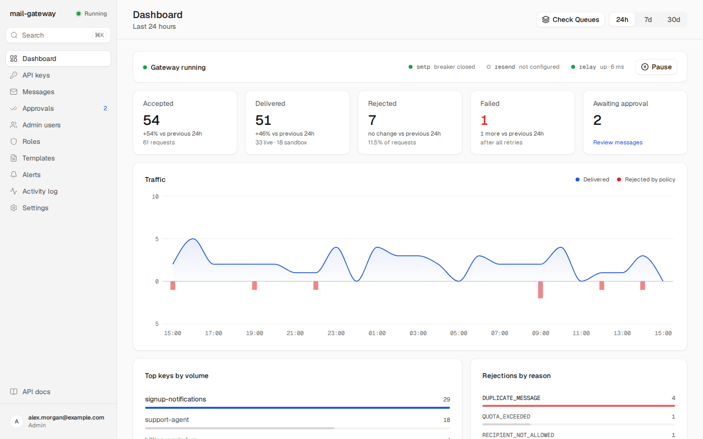
</picture>

The guardrails are the product:

| Guardrail | What it does |
|---|---|
| Per-key policy | Fixed sender, recipient allow-list (exact address, `@domain` or `*` for anyone), recipient/size/attachment limits |
| Sandbox by default | New keys only reach Mailpit until an admin promotes them |
| Approval mode | A message waits until an admin approves it |
| Quotas | Per key per hour and per day. Also a global hourly acceptance cap |
| Global rate limit | Paces deliveries to the provider across all workers |
| Dedup | Identical message (key + recipients + subject + body) within 10 min → `DUPLICATE_MESSAGE`. Catches agent loops; a key can opt out with `allowDuplicates` |
| Idempotency | Same `Idempotency-Key` within 24 h returns the original message |
| Circuit breaker | Repeated provider failures automatically pause the whole gateway |
| Content guardrails | Allowed link domains, max links, secrets in bodies (keys, tokens, card/bank numbers), attachment types checked against their content, optional ClamAV |
| Templates | Keys can be limited to server-side templates: clients send variables, not content |
| Reputation limits | Per destination-domain hourly caps across keys, warm-up of new live keys, optional SPF/DKIM/DMARC checks before going live |
| Key access | Source IP allow-lists, expiry dates, rotation with a grace period |
| Alerts | Webhook / Slack / email on breaker trips, pauses, rejection or failure spikes, quotas, waiting approvals, expiring keys and a broken audit chain |
| Kill switches | Disable a single key, or pause the whole gateway |
| Audit log | Every request after authentication (accepted or rejected), with full body (encrypted at rest, retention-limited), transitions and provider responses. Admin actions go to a tamper-evident hash chain |

---

## Architecture

```
 clients / agents ──HTTP──▶ api ──────▶ BullMQ (Redis) ──▶ worker ──▶ live:    existing SMTP  |  Resend API
   (Bearer mk_...)           │  ▲                            │          sandbox: Mailpit
                             │  └── /webhooks/resend ◀───────┼──────────── Resend delivery events
                             ▼                               ▼
                         PostgreSQL: keys + policies, messages (audit), events, hourly stats, admin_audit
```

- **api** (`dist/main.api.js`) runs `/v1` (public), `/admin` (API + UI auth), `/ui` (admin web UI), `/webhooks/resend`, `/health/*`, `/docs` (Scalar), `/swagger` and `/openapi.json`.
  It enforces the whole policy **synchronously** before anything is queued.
- **worker** (`dist/main.worker.js`) delivers messages, runs retries and the circuit breakers, and runs the daily retention job.
  **Only the worker holds provider credentials** (SMTP password, Resend API key).
- Both run from one image; only the command differs. A one-shot `migrate` service runs `prisma migrate deploy` first.
- Both expose `/metrics` and `/health/*` on an internal port (`METRICS_PORT`, default 9464). Compose does not publish that port.

---

## Run it in one minute (prebuilt images)

No clone needed. Get [`deploy/compose.yaml`](deploy/compose.yaml) and [`deploy/.env.example`](deploy/.env.example) into an empty folder and start it:

```bash
mkdir mail-gateway && cd mail-gateway
base=https://raw.githubusercontent.com/Tomasneto404/mail-gateway/master/deploy
curl -fsSLo compose.yaml $base/compose.yaml
curl -fsSLo .env $base/.env.example   # optional: every setting has a default
docker compose up -d --wait
docker compose logs admin             # sign-in email and the generated password
```

Open <http://localhost:3000/ui>. Mailpit, the sandbox inbox, is at <http://localhost:8025>. To open it from the Messages page (**Sandbox Messages**), enter that address once under **Settings → Sandbox**.

- **Settings:** everything lives in `.env` (see [`deploy/.env.example`](deploy/.env.example)). Its values fill the compose file and are passed to the gateway, so any setting from the main `.env.example` can be added without editing `compose.yaml`.
- **Folders:**

  | Folder | Contents |
  |---|---|
  | `./secrets` | Generated on the first start: database password, encryption key and the first admin's password (`./secrets/admin_password`) |
  | `./data/postgres`, `./data/redis`, `./data/mailpit` | The database, the queue/quotas and the sandbox inbox |
  | `./backups` | Scheduled database dumps |

  Back these folders up together. The secrets encrypt data in the database.
- **First administrator:** `admin@example.com` unless you set `MG_ADMIN_EMAIL`. Migrations run before the API starts.
- **Sandbox by default:** every key starts in sandbox mode and delivers to Mailpit, so nothing reaches a real inbox. For live keys, fill `SMTP_HOST`, `SMTP_PORT`, `SMTP_USER` and `SMTP_PASSWORD` (or Resend) in `.env`.
- **Images:** `tomasneto26/mail_gateway` on Docker Hub by default.
  - For a private registry, set `MG_IMAGE=registry.example.com/infra/mail-gateway` after `docker login`.
  - To pin a version, set `MG_TAG=1.0.3`. To update, run `docker compose pull && docker compose up -d`.
- **Network:** ports are published on `127.0.0.1` only (`MG_BIND`, `MG_HTTP_PORT`, `MG_MAILPIT_PORT`). Before exposing the gateway, put it behind HTTPS and set `COOKIE_SECURE=true` and `PUBLIC_URL`.
- **Backups:** the `backup` service writes a `pg_dump` to `./backups` every `MG_BACKUP_INTERVAL_HOURS` (24; 0 = off) and keeps `MG_BACKUP_KEEP_DAYS` (14). Keep `./secrets` with them: bodies are encrypted with the key stored there. Restore:
  ```bash
  docker compose exec -T backup sh -c 'PGPASSWORD=$(cat /run/mg/postgres_password) pg_restore --clean --if-exists -d mailgw' < backups/mailgw-<date>.dump
  ```
- **Starting over:** `docker compose down`, then `sudo rm -rf data secrets`. The data folders belong to the containers' users, hence `sudo`.

## Quickstart (from source)

```bash
cp .env.example .env
# required: POSTGRES_PASSWORD and APP_ENCRYPTION_KEY (encrypts TOTP secrets)
sed -i "s/^POSTGRES_PASSWORD=.*/POSTGRES_PASSWORD=$(openssl rand -hex 16)/; s#^APP_ENCRYPTION_KEY=.*#APP_ENCRYPTION_KEY=$(openssl rand -base64 32)#" .env
docker compose up -d --wait          # postgres, redis, mailpit, migrate, api, worker

# first administrator (prompts for a password)
docker compose exec api node dist/cli.js users:create --email you@company.com --role admin
```

Then open <http://127.0.0.1:3000/ui/> and sign in. Enabling two-factor authentication (account menu → *Two-factor authentication*) is recommended.

- API: <http://127.0.0.1:3000> (`API_BIND`/`API_PORT`). API reference (Scalar): <http://127.0.0.1:3000/docs>; Swagger UI: `/swagger`.
- `./scripts/smoke.sh` runs an end-to-end check of the API through the CLI. It needs no UI login.
- Mailpit UI (dev only, from `compose.override.yml`): <http://127.0.0.1:8025>. Set it as the Mailpit URL under **Settings → Sandbox** to get the **Sandbox Messages** button on the Messages page.
- Production: `docker compose -f docker-compose.yml up -d`. Add `-f compose.secrets.yml` to use Docker secrets (see [Secrets](#secrets)).

> The stack's network uses `MAIL_GATEWAY_SUBNET` (default `10.213.7.0/24`). If it overlaps a route on the host
> (VPN, LAN; check `ip route`), published ports hang and the worker can't reach the SMTP relay. Pick a free range in `.env`.

### Create the first key

Use the CLI inside the api container (no admin API needed):

```bash
docker compose exec api node dist/cli.js keys:create \
  --name report-agent --from reports@yourcompany.com --from-name "Report Agent" \
  --allow @yourcompany.com --allow ops@partner.com --quota-hour 20 --quota-day 100
```

The secret (`mk_sbx_...`) is printed **once**; only its SHA-256 hash is stored. New keys are always in `sandbox` mode.
To let a key email anyone, use `--allow '*'` (quoted, so the shell does not expand it).

You can also use the **admin UI** (API keys → New key), which walks you through it and shows the secret once.
For automation there is the admin API with the static token; set `ADMIN_TOKEN_ENABLED=true`, as it's disabled by default:

```bash
curl -sX POST localhost:3000/admin/keys -H "Authorization: Bearer $ADMIN_TOKEN" -H 'Content-Type: application/json' \
  -d '{"name":"report-agent","fromAddress":"reports@yourcompany.com","allowedRecipients":["@yourcompany.com"]}'
```

### Send

```bash
curl -sX POST localhost:3000/v1/send \
  -H "Authorization: Bearer mk_sbx_..." -H 'Content-Type: application/json' -H 'Idempotency-Key: nightly-2026-11-16' \
  -d '{"to":"alice@yourcompany.com","subject":"Nightly report","text":"All green.","metadata":{"job":"nightly"}}'
# → 202 {"id":"01a1…","status":"queued"}

curl -s localhost:3000/v1/messages/01a1… -H "Authorization: Bearer mk_sbx_..."
# → {"status":"captured", "attempts":1, ...}       (sandbox → Mailpit)

curl -s localhost:3000/v1/me -H "Authorization: Bearer mk_sbx_..."
# → policy + {"usage":{"hour":{"used":1,"limit":20,"remaining":19},"day":{...}}}
```

### Promote sandbox → live

In the UI, open **API keys → key → Policy**, set mode to *Live* and save. A warning explains the impact, and you must confirm before it applies. From a shell:

```bash
# admin API
curl -sX PATCH localhost:3000/admin/keys/<id> -H "Authorization: Bearer $ADMIN_TOKEN" \
  -H 'Content-Type: application/json' -d '{"mode":"live"}'
# or CLI
docker compose exec api node dist/cli.js keys:update --name report-agent --mode live
```

- The change takes effect on the next request. It is logged in `admin_audit` as `key.promote_live`.
- The key keeps its `mk_sbx_` prefix, which is only a label from when it was issued; `prefixStale: true` flags the mismatch.
  Rotate the key (`keys:rotate`) to get an `mk_live_` secret.
- `approval` mode also delivers live, but only after an admin approves each message.

---

## Policy reference

| Field | Default | Meaning |
|---|---|---|
| `name` | required | Unique; sent as the `X-Mail-Gateway-Key` header |
| `description` | `""` | |
| `enabled` | `true` | Kill switch. `false` rejects every send with `KEY_DISABLED` |
| `mode` | `sandbox` | `sandbox` → Mailpit only. `live` → real delivery. `approval` → held as `pending_approval` until approved |
| `fromAddress` | required | Fixed sender. Clients cannot override it (`FROM_NOT_ALLOWED`) |
| `fromName` | `null` | Optional display name |
| `allowReplyTo` | `false` | Whether clients may set `replyTo` |
| `allowedRecipients` | `[]` | Exact addresses, `@domain` entries (exact domain, no subdomains) and/or `*` (any recipient, in every mode; quotas, `maxRecipientsPerMessage` and `RECIPIENT_DOMAIN_LIMITS` still apply). **Empty = reject everything.** Every to/cc/bcc must match |
| `maxRecipientsPerMessage` | `DEFAULT_MAX_RECIPIENTS` (10) | Applies to to + cc + bcc |
| `maxMessageBytes` | 1 MB | Subject + text + html + decoded attachments |
| `quotaPerHour` / `quotaPerDay` | 50 / 200 | Accepted messages per UTC hour/day |
| `attachmentsAllowed` | `false` | |
| `maxAttachmentBytes` | 5 MB | Decoded total |
| `liveProvider` | `null` | `smtp` \| `resend` \| `null` (use `LIVE_PROVIDER`) |
| `allowedIps` | `[]` | Source IPs / CIDR ranges allowed to use the key (`IP_NOT_ALLOWED`). Empty = any |
| `expiresAt` | `null` | The key stops working after this instant (`KEY_EXPIRED`); an alert goes out `ALERT_KEY_EXPIRY_DAYS` before |
| `allowedLinkDomains` | `[]` | Domains links in the body may point to, subdomains included (`LINK_NOT_ALLOWED`). Empty = any |
| `maxLinks` | `null` | Max distinct links per message (`TOO_MANY_LINKS`). `null` = unlimited |
| `blockSecrets` | `true` | Refuses bodies with cloud/API keys, tokens, private keys, passwords in URLs, card numbers (Luhn) and IBANs (`CONTENT_BLOCKED`) |
| `allowedAttachmentTypes` | `[]` | MIME types (`image/*` wildcards). The content is checked against the declared type. Executables and scripts are always refused (`ATTACHMENT_TYPE_NOT_ALLOWED`) |
| `scanAttachments` | `false` | ClamAV scan (`CLAMAV_HOST`), fail-closed (`ATTACHMENT_INFECTED`, `ATTACHMENT_SCAN_UNAVAILABLE`) |
| `allowDuplicates` | `false` | Accept identical messages inside the dedup window instead of `DUPLICATE_MESSAGE` (UI: Options → Allow repeated messages; CLI: `--allow-duplicates` / `--no-allow-duplicates`). Quotas still apply |
| `templatesOnly` | `false` | Only server-side templates may be sent (`TEMPLATE_REQUIRED`) |
| `allowedTemplates` | `[]` | Template names the key may use (`TEMPLATE_NOT_ALLOWED`). Empty = any |
| `warmup` | `true` | After the key first leaves sandbox, the daily quota is capped by `WARMUP_SCHEDULE` (day 1, 2, …) |

Gateway-wide: `RECIPIENT_DOMAIN_LIMITS` caps recipients per destination domain per hour across all keys for live/approval mail (`DOMAIN_RATE_LIMITED`). `SENDER_DOMAIN_CHECKS=warn|enforce` checks SPF, DMARC and DKIM of each key's sender domain; `enforce` refuses to take a key out of sandbox while SPF or DMARC fail (`DOMAIN_NOT_VERIFIED`).

Rotation can keep the previous secret valid for a grace period (`POST /admin/keys/{id}/rotate {"graceMinutes": 60}`, or `keys:rotate --grace-minutes 60`), so clients switch without downtime; `/v1/me` tells them until when (`previousSecretValidUntil`).

Each outgoing message carries `X-Mail-Gateway-Key: <key name>` and `X-Mail-Gateway-Message-Id: <id>`.

### Templates

Server-side templates keep the content in the gateway; clients (agents in particular) only fill values. Variables are written `{{name}}`, every one is required, unknown ones are refused, values are HTML-escaped in the HTML body and may not contain line breaks in the subject.

```bash
curl -s localhost:3000/v1/templates -H "Authorization: Bearer $KEY"     # what this key may send, with the variables
curl -s localhost:3000/v1/send -H "Authorization: Bearer $KEY" -H 'Content-Type: application/json' \
  -d '{"to":"ana@example.com","template":"password-reset","variables":{"name":"Ana","link":"https://app.example.com/r/abc","minutes":30}}'
```

Templates are managed on the **Templates** page (`templates:read` / `templates:manage`), with a preview. A key with `templatesOnly` can only send templates, which removes free-form content (and prompt-injected text) from what it can emit.

The HTML body can be loaded from a file (**Load file**): pick the `.htm`/`.html` page together with the images it uses. The page is decoded with its own character set (Word and Outlook save in windows-1252), Word markup is cleaned up, and the images are embedded. On delivery, embedded images are sent as inline attachments (`cid:`), which Gmail and Outlook display; they count toward `maxMessageBytes`.

### Send request (`POST /v1/send`)

| Field | Notes |
|---|---|
| `to` | string or array; plain addresses only |
| `cc`, `bcc` | optional, same rules |
| `subject` | required, 1–998 chars, no CR/LF |
| `text` / `html` | at least one |
| `replyTo` | only if `allowReplyTo` |
| `attachments` | `[{filename, content (base64), contentType?}]`, only if `attachmentsAllowed` |
| `metadata` | object ≤ 8 KB, stored with the message and never sent |

Header `Idempotency-Key` (optional): the same key within 24 h returns the original message, with `Idempotent-Replayed: true`.

### Errors

Every error has the shape `{"error":{"code","message","details?"}}`. The messages are written so that an LLM agent can tell what to change.

| Code | HTTP | Meaning |
|---|---|---|
| `UNAUTHORIZED` / `INVALID_API_KEY` | 401 | Key missing / wrong / rotated / deleted |
| `AUTH_RATE_LIMITED` | 429 | Too many failed auth attempts from this IP (`Retry-After`) |
| `KEY_DISABLED` | 403 | Kill switch active |
| `GATEWAY_PAUSED` | 503 | Paused by an admin or by the circuit breaker |
| `VALIDATION_FAILED` / `INVALID_JSON` / `REQUEST_TOO_LARGE` | 400/400/413 | Malformed request (includes CR/LF header-injection attempts) |
| `FROM_NOT_ALLOWED` | 400 | Client tried to set the sender |
| `RECIPIENT_NOT_ALLOWED` | 403 | `details.notAllowed`, `details.allowedRecipients` |
| `TOO_MANY_RECIPIENTS` / `REPLY_TO_NOT_ALLOWED` / `ATTACHMENTS_NOT_ALLOWED` | 400 | |
| `MESSAGE_TOO_LARGE` / `ATTACHMENT_TOO_LARGE` | 413 | |
| `DUPLICATE_MESSAGE` | 409 | Same message within the dedup window, probably a loop |
| `IDEMPOTENCY_CONFLICT` | 409 | Same Idempotency-Key still in flight |
| `QUOTA_EXCEEDED` / `GLOBAL_RATE_LIMITED` | 429 | `details.retryAfterSeconds` + `Retry-After` |
| `PROVIDER_UNAVAILABLE` | 503 | The key's live provider is not enabled on this gateway |

Message statuses: `queued`, `pending_approval`, `sent` (live provider accepted it), `captured` (sandbox), `failed`, `rejected`.
With Resend webhooks, `deliveryOutcome` adds `delivered` / `delayed` / `bounced` / `complained`.

---

## LLM agents

- The OpenAPI spec lives at `/openapi.json` (YAML at `/openapi.yaml`), and the committed copy is [`openapi.json`](openapi.json).
- The human-readable reference is **Scalar** at `/docs`, with Swagger UI kept at `/swagger`.
  - Scalar is **self-hosted**: the bundle is copied into `dist/docs-assets` at build time, so there is no CDN.
  - It runs under a strict CSP with no inline scripts.
  - Telemetry, Scalar's web fonts, its AI agent and its request proxy are disabled, so `/docs` never contacts anything outside the gateway.
  - "Test Request" calls the gateway directly (same origin) with the API key you enter; the key is not persisted.
  Operations have stable ids (`sendEmail`, `getMessageStatus`, `getMyPolicy`) and field descriptions written for function-calling.
- Recommended agent loop:
  1. Call `getMyPolicy` once.
  2. Send with an `Idempotency-Key`.
  3. On `4xx`, read `error.message` and change the request; don't retry blindly.
  4. On `429`/`503`, wait for `Retry-After`.
- An MCP endpoint is **deferred**. `SendService.submit()` is the single pipeline every entry point uses, so an MCP tool can be added later without duplicating any policy logic.

---

## Admin UI (`/ui`)

A React single-page app, served by the API on the same origin, so no CORS is involved. Its API client and types are generated from
`openapi.json`, so the UI can't drift from the backend (`npm run gen:api -w ui`).

The gateway's state is always in view as a **signal light** at the top of the sidebar: green while it accepts and delivers, amber when an admin paused it, red when a provider's circuit breaker tripped. Statuses and modes use the same language everywhere: a dot and a word, solid once reached, hollow while waiting or stopped before sending.

| Screen | What you can do |
|---|---|
| **Dashboard** | Gateway state, breaker state per provider, relay health and pause/resume. Traffic chart with delivered mail above the axis and policy rejections below it, accepted/delivered/rejected/failed counts, pending approvals, top keys and rejections by reason. **Check Queues** opens a live view of every BullMQ queue |
| **API keys** | List with today's/hour's usage against quota. Create wizard that shows the secret once. Key page with policy editor (mode with a live-promotion warning, sender, recipient chips, source IPs and expiry, quotas and warm-up, attachments, link domains and secret blocking, templates, provider), sender-domain check, 24 h usage chart, recent messages, rotate (with a grace period), enable/disable, delete and **Send test email** |
| **Messages** | Search by status, key, recipient, subject and date range. Detail drawer with the message's route (received → queued → delivered / failed, or stopped by policy), metadata, status timeline, attempts, provider response, headers and text body. The HTML body is shown in a sandboxed iframe. **Sandbox Messages** opens Mailpit (with its message count) when a Mailpit URL is set on **Settings → Sandbox**; it is shown only to roles with `messages:bodies`, since Mailpit shows full bodies without the gateway's access control, and is disabled while Mailpit does not answer at the health check URL (same card, default `http://<MAILPIT_SMTP_HOST>:8025`) |
| **Approvals** | Inbox of `pending_approval` messages with preview, approve/reject (with reason) and bulk actions |
| **Admin users** | Invite a user with roles (one-time link), edit roles, reset 2FA, reset password, disable, delete |
| **Roles** | RBAC: create/edit roles as sets of permissions, map Authentik groups to roles |
| **Templates** | Server-side templates with `{{variables}}`, preview with sample values, which keys allow each one |
| **Alerts** | Channels (HMAC-signed webhook, Slack, email) with per-type subscriptions and a test button; alert history |
| **Activity log** | The `admin_audit` table, filterable by action, actor and outcome, and scoped per user or per API key. **Verify integrity** checks the hash chain |
| **Settings** | Effective configuration without secrets, read-only except **Sandbox**: the Mailpit URL people open from Messages and the internal URL used to check it (stored in the database, changed with `settings:manage`, recorded in the activity log) |

<table>
  <tr>
    <td width="50%">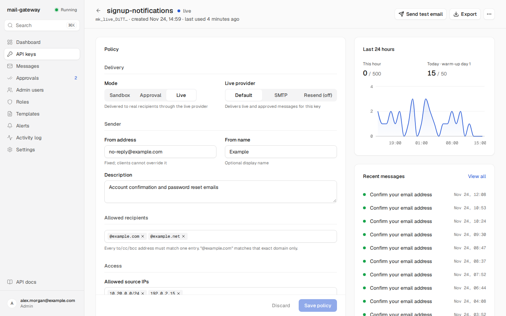</td>
    <td width="50%">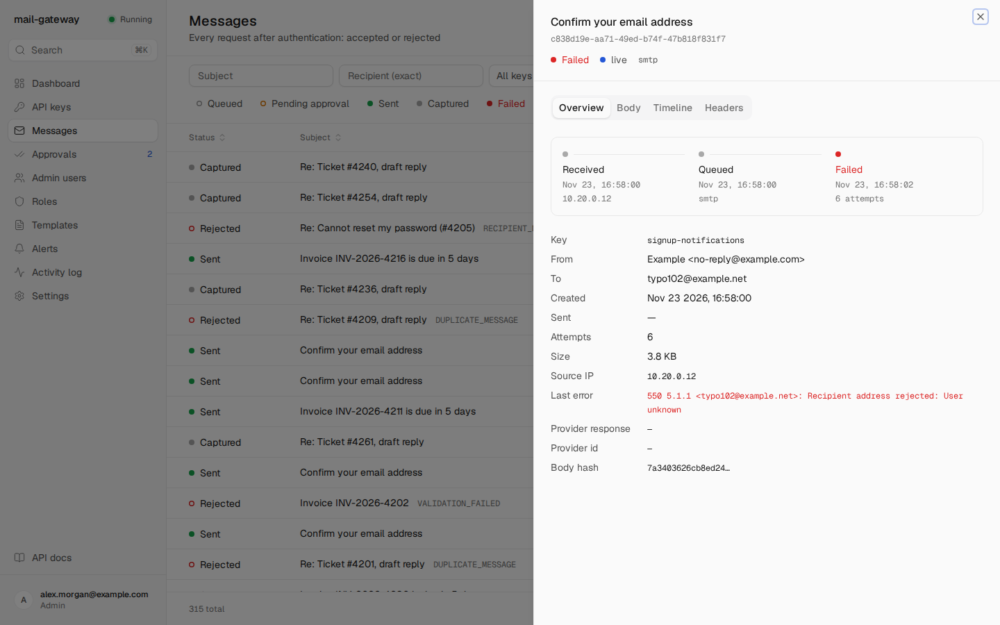</td>
  </tr>
  <tr>
    <td><sub><b>API key</b>: the policy editor, quota usage and the key's recent messages</sub></td>
    <td><sub><b>Message detail</b>: the route a message took and the relay's answer</sub></td>
  </tr>
  <tr>
    <td>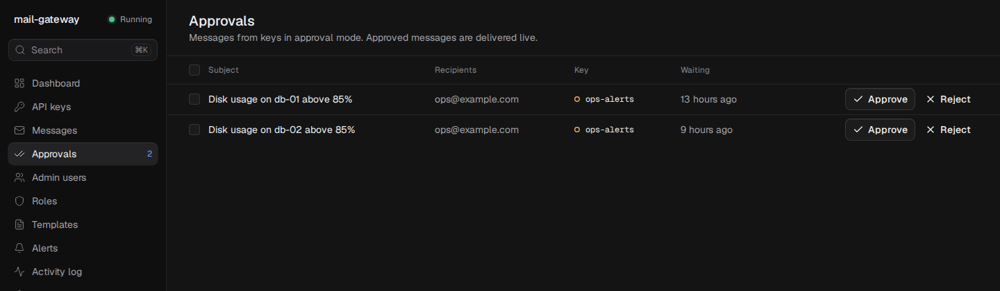</td>
    <td></td>
  </tr>
  <tr>
    <td><sub><b>Approvals</b>: mail from approval-mode keys waits for a human</sub></td>
    <td><sub><b>Roles</b>: permissions per role, Authentik groups mapped onto roles</sub></td>
  </tr>
  <tr>
    <td>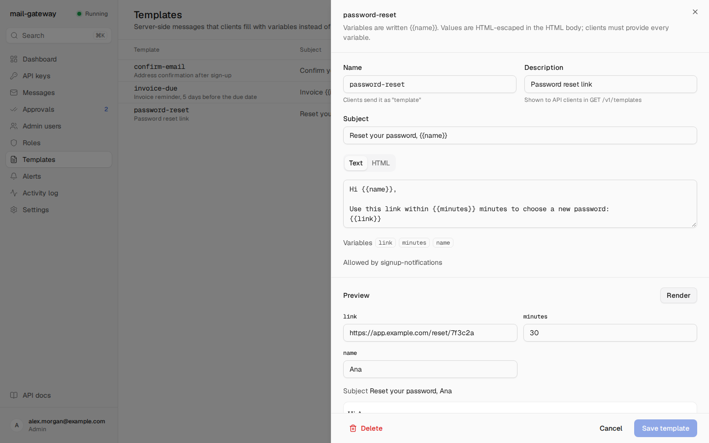</td>
    <td>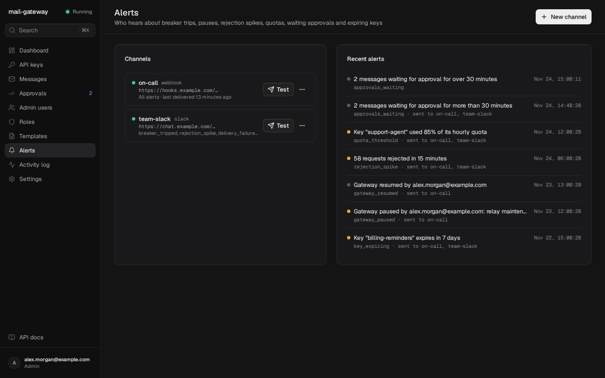</td>
  </tr>
  <tr>
    <td><sub><b>Templates</b>: <code>{{variables}}</code>, the keys that may send each one, and a preview with sample values</sub></td>
    <td><sub><b>Alerts</b>: where breaker trips, spikes, quotas and expiring keys are sent, and what was sent</sub></td>
  </tr>
  <tr>
    <td></td>
    <td>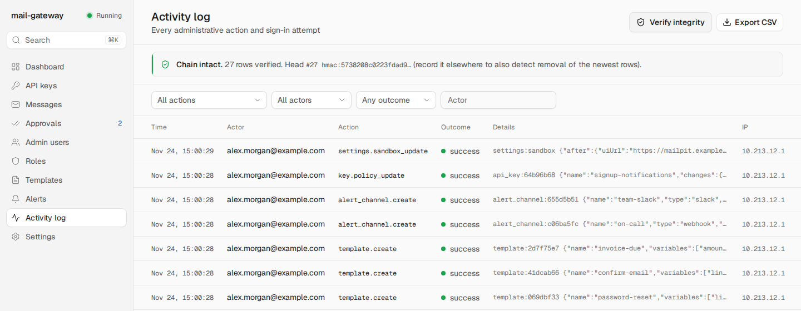</td>
  </tr>
  <tr>
    <td><sub><b>Content guardrails</b>: link domains, secret blocking, templates-only keys and warm-up</sub></td>
    <td><sub><b>Activity log</b>: the hash chain checked from the UI</sub></td>
  </tr>
  <tr>
    <td>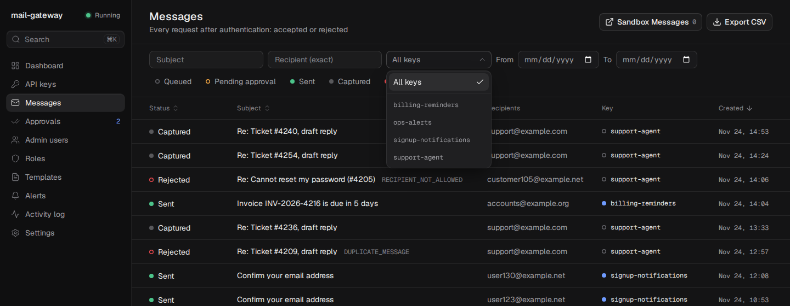</td>
    <td>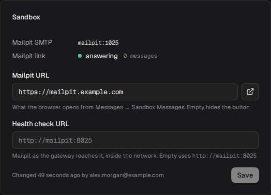</td>
  </tr>
  <tr>
    <td><sub><b>Messages</b>: filters, <b>Sandbox Messages</b> (opens Mailpit) and CSV export</sub></td>
    <td><sub><b>Settings → Sandbox</b>: the Mailpit link is set here, not in <code>.env</code></sub></td>
  </tr>
</table>

<sub>Screenshots use demo data on `example.com` domains.</sub>

**CSV exports.** Messages can be exported by API key or with any list filter, and the activity log in general, per user or per API key:
- From the UI: *Export* buttons on Messages, the key page, Activity log and Admin users.
- From the API: `GET /admin/messages/export.csv?keyId=…` and `GET /admin/audit/export.csv?actorId=…|keyId=…`.

Details:
- Choose `,` or `;` as the separator (`delimiter=semicolon` for Excel in Portuguese and similar locales). Files are UTF-8 with a BOM.
- Message bodies are never exported.
- Cells that could run as spreadsheet formulas are neutralised (CSV injection).
- Exports need `messages:read` / `audit:read`, stream in batches, are capped at `EXPORT_MAX_ROWS`, and are themselves recorded in the activity log.

Keyboard: `⌘K` / `Ctrl+K` opens the command palette, and `g d`, `g k`, `g m`, `g a`, `g u`, `g r`, `g t`, `g n`, `g l`, `g s` jump between screens. Light, dark and system themes are available.

**On a phone** the sidebar folds into a menu button, stat tiles stack two per row and tables scroll sideways, so approving a held message or pausing the gateway works from anywhere.

<table>
  <tr>
    <td width="30%">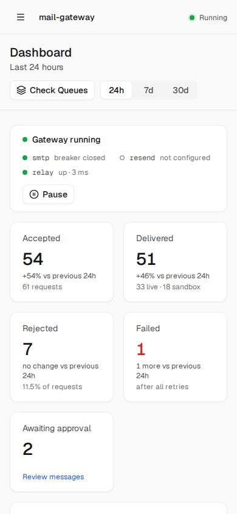</td>
    <td width="30%">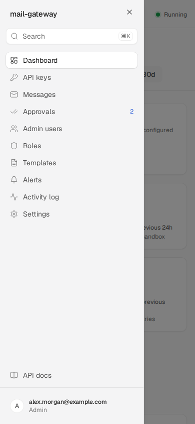</td>
  </tr>
</table>

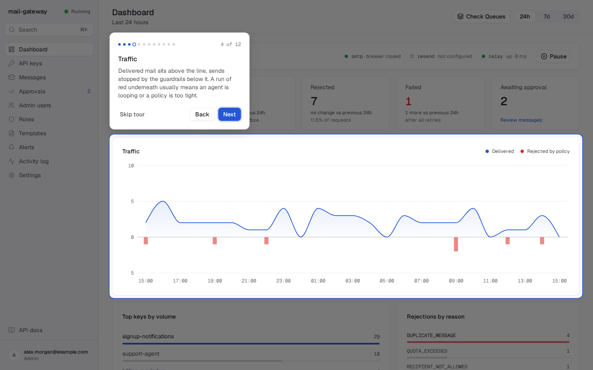

Guided tour: new users are offered a two-minute tour in the sidebar. It walks through the signal light, pausing the gateway, the traffic chart, keys and their policy, the message log, approvals, the activity log and roles. Steps the user's roles cannot reach are left out. Restart it at any time from the account menu (**Guided tour**) or the command palette. "Seen" is remembered per user in the browser (localStorage). Keys during the tour: `→` next, `←` back, `Esc` leaves. To point a new step at an element, give it `data-tour="<name>"` and add the step in `ui/src/components/tour/steps.ts`.

Confirmations:
- Pausing the gateway, rejecting messages and promoting a key to live ask for confirmation.
- Disabling, rotating or deleting a key requires typing its name.
- All of these take effect immediately and are logged in the activity log.

### Authentication and roles

- **Local accounts.**
  - Passwords are hashed with argon2id and must be at least 12 characters.
  - TOTP two-factor is **optional by default**. Each user turns it on from the account menu by scanning a QR code and confirming a code.
    Once on, the code is required at every sign-in, and turning it off requires the current password.
  - Set `TOTP_REQUIRED=true` to make TOTP mandatory for every local user: it is set up at first sign-in and can't be disabled.
  - TOTP secrets are encrypted with AES-256-GCM using `APP_ENCRYPTION_KEY`, and a TOTP code can't be reused.
  - **Passkeys** (WebAuthn: platform passkeys or security keys) can be added from the account menu and work as the second factor instead of a TOTP code. They need HTTPS or `localhost`; the relying party is `PUBLIC_URL`'s host.
  - From the account menu each user can also **change their password** (their other sessions are signed out) and **see and sign out their sessions**.

    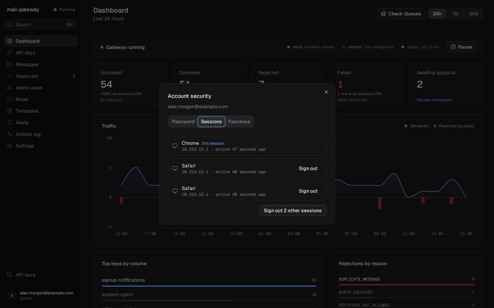
- **Rate limits.** The account locks after `LOGIN_MAX_FAILURES` failed attempts, and login attempts are also rate-limited per IP.
- **Sessions.**
  - Server-side sessions use a `__Host-mg_session` cookie: httpOnly, Secure, SameSite=Strict.
  - Sessions expire after `SESSION_IDLE_MINUTES` of inactivity, and after `SESSION_TTL_HOURS` at most.
  - The session id is rotated after the second factor.
- **CSRF.** Every state-changing request needs a per-session token in `X-CSRF-Token` **and** a same-origin `Origin`.
  Set `PUBLIC_URL` when the gateway sits behind a TLS-terminating proxy.
- **Authentik SSO** (optional): each role lists the Authentik groups that grant it, edited on the Roles page.
  Users are created on first login, and their roles are re-synced from their groups at every login. See [docs/authentik.md](docs/authentik.md).
- **Roles (RBAC).** Each role is a set of permissions, and a user can hold several roles; they get the union of the permissions.
  - Permissions: `dashboard:read`, `keys:read|create|update|promote|rotate|disable|delete|test_send`, `messages:read|bodies`,
    `approvals:decide`, `gateway:pause`, `users:read|manage`, `roles:manage`, `templates:read|manage`, `alerts:read|manage`, `audit:read`, `settings:read|manage`.
    A role can also hold `<area>:*` or `*`.
  - Built-in roles:

    | Role | Grants |
    |---|---|
    | **Admin** | `*`; can't be changed or deleted |
    | **Operator** | keys (except promote/delete), gateway pause, read-only views |
    | **Approver** | approvals and message bodies |
    | **Auditor** | read-only everything, including bodies and users |
    | **Viewer** | read-only, bodies hidden |
    | **Body reader** | add-on that only grants `messages:bodies` |

    Built-ins can't be deleted or renamed. You can create your own roles in **Roles**.
  - Promoting a key out of sandbox (to live or approval) needs `keys:promote`. Other policy edits need `keys:update`.
  - **Anti-escalation:** nobody can create a role, or grant, revoke or affect permissions, beyond what they hold themselves.
    That includes disabling or deleting a more privileged user.
  - At least one active user with full access (`*`) always remains.
  - Changes to roles and assignments apply on the user's very next request. Every change is audited.
  - The server enforces permissions on every endpoint; the UI only hides what you can't use.
- **Bootstrap.**
  - The first admin is created with the CLI (`users:create`); there is no sign-up page.
  - Other users are invited from the UI with a one-time link, or created with the CLI.
  - When `SYSTEM_MAIL_FROM` is set and SMTP or Resend is enabled, invitations and password resets are **emailed** to the user.
    The worker sends them through the live provider; the API never holds provider credentials. The link is also shown in the UI as a fallback.
    Invite tokens are masked in request logs.
- **Static admin token.** Only for CLI and automation, and **disabled by default** (`ADMIN_TOKEN_ENABLED`).
- **Audit.** Every admin action is written to `admin_audit` and emitted as a structured `admin_action` log event.
  This covers key create/update/promote/rotate/disable/delete, test sends, approve/reject, pause/resume, user changes, enabling/disabling 2FA and login success/failure.

User CLI:

```bash
docker compose exec api node dist/cli.js users:create --email a@b.c [--role Admin --role Viewer …] [--password-stdin]   # default role: Admin
docker compose exec api node dist/cli.js users:list | roles:list | users:reset-2fa --email … | users:reset-access --email … | users:disable --email …
```

### Security headers

- **`/ui`** is served with a strict CSP: `script-src 'self'` (no inline scripts), `frame-ancestors 'none'`, `object-src 'none'`, `base-uri 'none'`, plus `X-Frame-Options: DENY`.
- **HTML message previews** come from `/admin/messages/:id/preview`.
  - The response has its own policy: `default-src 'none'; style-src 'unsafe-inline'; img-src data: cid:; sandbox`.
  - The UI embeds it in an `<iframe sandbox="">`: scripts never run, and the frame has an opaque origin.
  - Remote images are blocked until the user explicitly clicks *Load remote images*.
  - `<meta refresh>` and `<base>` tags are removed.

---

## Operations

Everything below can also be done from the admin UI. Admin API calls need a UI session, or the static token if it's enabled.

| Task | Admin API | CLI (`docker compose exec api node dist/cli.js ...`) |
|---|---|---|
| Pause everything | `POST /admin/gateway/pause {"reason"}` | `gateway:pause --reason "..."` |
| Resume (also resets breakers) | `POST /admin/gateway/resume` | `gateway:resume` |
| Gateway state | `GET /admin/gateway` | `gateway:status` |
| Kill one key | `POST /admin/keys/:id/disable` | `keys:disable --name x` |
| Rotate | `POST /admin/keys/:id/rotate` | `keys:rotate --name x` |
| Approve / reject | `POST /admin/messages/:id/approve` · `/reject {"reason"}` · bulk `POST /admin/messages/approve {"ids":[...]}` | `messages:approve --id` |
| Search audit log | `GET /admin/messages?status=rejected&keyId=&recipient=&subject=&from=&to=&page=&pageSize=&sort=&order=` | |
| Mailpit link (Sandbox Messages) | `GET` / `PUT /admin/settings/sandbox {"uiUrl","apiUrl"}` (`settings:manage`) | |

**Circuit breaker.** There is one breaker per live provider. It trips after `BREAKER_CONSECUTIVE_FAILURES` consecutive
transport-level failures (connection errors, TLS/auth errors, 421), or when the failure rate in `BREAKER_WINDOW_SECONDS`
reaches `BREAKER_FAILURE_RATE` over at least `BREAKER_MIN_SAMPLES` attempts. A trip pauses the gateway: the API answers
`GATEWAY_PAUSED`, and queued jobs stay parked, not lost. The admin audit log records the pause as `system`. Only an admin resume
re-opens the gateway.

**Retries.** Transient errors are retried with exponential backoff (`DELIVERY_BACKOFF_MS`, up to `DELIVERY_MAX_ATTEMPTS`).
These are SMTP 4xx and network errors, or Resend 429/5xx. Permanent errors (5xx, Resend validation) fail immediately.
Every attempt is recorded in the message timeline.

**Retention.** A daily job in the worker (`RETENTION_CRON`, UTC) nulls bodies and attachments older than `AUDIT_BODY_RETENTION_DAYS` (30).
It deletes message rows, events, stats and admin audit entries older than `AUDIT_RECORD_RETENTION_DAYS` (365).

**Logs.** pino JSON on stdout, ready for a SIEM. Every event carries `event`, `keyName`, `messageId`, `outcome` and `reason`.
Events: `message_accepted`, `policy_rejected`, `auth_failed`, `auth_rate_limited`, `delivery_succeeded|retry|failed`,
`provider_event`, `breaker_tripped`, `gateway_paused|resumed`, `admin_action`, `retention_completed`.
API keys, the admin token, cookies, SMTP credentials and message bodies are never logged; bodies exist only in the audit table.

**Metrics** (`:9464/metrics` on api and worker, internal network only):
`mg_messages_total{status,key}`, `mg_rejections_total{reason,key}`, `mg_auth_failures_total{reason}`,
`mg_queue_depth{state}`, `mg_gateway_paused`, `mg_pending_approvals`, `mg_provider_send_duration_seconds{provider,outcome}`,
`mg_circuit_breaker_state{provider}`, `mg_circuit_breaker_trips_total{provider}`, `mg_delivery_outcomes_total{outcome,key}`,
and process metrics (`mg_process_*`).

**Queues (BullMQ).** All four queues (`delivery`, `system-mail`, `alerts`, `maintenance`) are measured:

| Metric | Process | What it tells you |
|---|---|---|
| `mg_queue_jobs{queue,state}` | api | Jobs waiting, active, delayed, prioritized, failed and completed (kept) |
| `mg_queue_oldest_waiting_seconds{queue}` | api | Age of the oldest job ready to run: the clearest sign of a stuck queue |
| `mg_queue_workers{queue}` | api | Worker processes connected (0 = nothing is consuming) |
| `mg_queue_paused{queue}` | api | 1 while paused (the delivery queue pauses with the gateway) |
| `mg_queue_jobs_processed_total{queue,outcome}` | worker | `completed`, `failed` (no attempts left) and `retried` |
| `mg_queue_job_wait_seconds{queue}` | worker | Time from due to started, first attempts |
| `mg_queue_job_duration_seconds{queue,outcome}` | worker | Processing time per attempt |

`mg_queue_depth{state}` (delivery only) stays for existing dashboards. Workers also record BullMQ's own per-minute completed/failed counts in Redis (one day).

The same picture is in the admin UI: **Check Queues** on the dashboard opens a live view (refreshed every 5 s) with each queue's state, counts, workers, oldest waiting job, completed and failed per minute for the last hour, wait and run times (p50/p95) and retries from the last 200 completed jobs, and the most recent failures. Failure reasons are shown only to roles that may see that queue's content (`messages:read` for delivery, `users:read` for system mail, `alerts:read` for alerts). API: `GET /admin/queues` (`dashboard:read`).

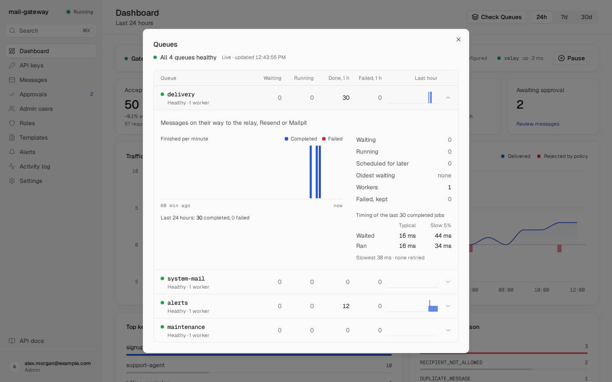

**Health.**
- `/health/live` is the liveness probe.
- `/health/ready` checks Postgres, Redis and TCP reachability of the SMTP relay. Use it for the HAProxy backend check.

### Behind HAProxy

- Set `TRUST_PROXY` to the HAProxy address(es), for example `TRUST_PROXY=10.0.0.10`. Client IPs (audit log, auth rate limiting) then come from `X-Forwarded-For`.
- Set `PUBLIC_URL` to the URL browsers use (`https://…`). The admin UI's Origin/CSRF check and the SSO redirect URI depend on it.
- Publish the API only on an internal interface (`API_BIND`).

### Resend

See [docs/resend.md](docs/resend.md): enable it with `RESEND_ENABLED=true` and `RESEND_API_KEY`, choose it globally with `LIVE_PROVIDER=resend` or per key with `liveProvider`, then configure the webhook.

### Secrets

Every secret can be passed as `<NAME>_FILE=/run/secrets/<file>`, the Docker secrets convention. Plain env vars still work for development.
`compose.secrets.yml` wires them up:

```bash
mkdir -p secrets && chmod 700 secrets
openssl rand -hex 24 > secrets/postgres_password
echo "postgresql://mailgw:$(cat secrets/postgres_password)@postgres:5432/mailgw" > secrets/database_url
openssl rand -hex 32 > secrets/admin_token
openssl rand -base64 32 > secrets/app_encryption_key
printf '%s' 'smtp-password' > secrets/smtp_password
printf '%s' 're_...' > secrets/resend_api_key; printf '%s' 'whsec_...' > secrets/resend_webhook_secret
docker compose -f docker-compose.yml -f compose.secrets.yml up -d
```

---

## Security notes

- API keys are 256-bit random values, stored only as SHA-256 hashes and checked with a constant-time comparison.
- Failed authentication is rate-limited per client IP.
- CR/LF is rejected in subject, addresses, names and filenames, so headers can't be injected. Only plain addresses are accepted.
- The request body has a hard size limit (`MAX_REQUEST_BYTES`). Unknown fields are rejected.
- The worker uses nodemailer with `disableFileAccess`/`disableUrlAccess`, so attachments can't read files or URLs.
- Containers run as non-root `node` with a read-only root filesystem, `cap_drop: ALL` and `no-new-privileges`. Every service has a healthcheck.
- **Hardened images:**
  - The base gets `apk upgrade`, and npm, npx, corepack and yarn are removed from both shipped images. They are never used at runtime and bring their own vulnerable dependencies.
  - The migrations image contains only the Prisma CLI, at the version from the lockfile.
  - A Trivy scan (`trivy image --scanners vuln`) reports 0 known vulnerabilities in both images.
- Admin UI: argon2id + optional (or enforced, `TOTP_REQUIRED`) TOTP, httpOnly/Secure/SameSite=Strict sessions, CSRF token + Origin check, lockout, a strict CSP and sandboxed email previews. See [Admin UI](#admin-ui-ui).
- Resend webhooks are verified with Svix signatures, and stale timestamps are rejected.
- **Data at rest:** message bodies and attachments are encrypted with AES-256-GCM using a key derived from `APP_ENCRYPTION_KEY` (rows written before are still readable; `node dist/cli.js messages:encrypt-bodies` converts them). Subjects and addresses stay searchable in clear. Alert channel URLs and webhook secrets are encrypted too.
- **Tamper-evident activity log:** each `admin_audit` row stores an HMAC (key derived from `APP_ENCRYPTION_KEY`) over its content and the previous row's hash. **Verify integrity** in the UI, `GET /admin/audit/verify` or `node dist/cli.js audit:verify` (exit code 3 when broken) detects edited, deleted, inserted or reordered rows; the retention job runs the check daily and raises an `audit_chain_broken` alert. Retention moves the chain's anchor instead of breaking it. To also detect removal of the newest rows, record the reported head hash outside the gateway.
- **Alerts:** webhooks carry `X-Mail-Gateway-Timestamp` and `X-Mail-Gateway-Signature: sha256=HMAC(secret, "<timestamp>.<body>")`; the secret is shown once when the channel is created.

---

## Development

```bash
npm ci                         # installs the backend and the ui/ workspace
npm run build                  # prisma generate + tsc
npm test                       # backend unit tests (Redis via testcontainers)
npm run test:integration       # full flow incl. admin auth + Authentik mock: Postgres, Redis, 2× Mailpit (Docker required)
npm run openapi:export         # regenerate openapi.json (a unit test fails on drift) …
npm run gen:api -w ui          # … then regenerate the UI client types
npm run test -w ui             # UI component tests (PolicyEditor)
npm run build -w ui            # UI static build → ui/dist (served at /ui)
npm run dev -w ui              # Vite dev server on :5173, proxying /admin and /v1 to :3000
npm run dev:api / dev:worker   # nest --watch (needs DATABASE_URL, REDIS_URL)

# load test (Python 3.9+, standard library only); refuses live keys unless --allow-live
MG_API_KEY=mk_sbx_… python3 scripts/stress_test.py --url http://localhost:3000 --scenario mixed -n 2000 -c 32 --poll 50
#   scenarios: send | mixed (valid + duplicates + bad recipients + CR/LF + idempotent replays) | rejected (nothing queued) | read
#   python3 scripts/stress_test.py --help for rate limits, duration, JSON output

# end-to-end against a running `docker compose up` (dev override):
npx playwright install chromium
npx playwright test -c ui/playwright.config.ts   # CLI admin → login → opt-in 2FA → create key → test send → Messages; preview sandbox; CSP
```

### CI

| Where | Workflows | Why |
|---|---|---|
| **GitHub Actions** (`.github/workflows/`) | **Test**, **E2E**, **Build & Push** | tests run here |
| **Forgejo** (`.forgejo/workflows/`) | **Build & Push** only | the internal runner lacks resources for the test suites |

The GitHub workflows run on pushes to `master`, on every PR and on demand:

| Workflow | Jobs |
|---|---|
| **Test** (`test.yml`) | *checks*: typecheck (backend + UI), stale-OpenAPI-client check, backend unit tests (including the OpenAPI drift test), UI component tests, build. *integration*: the full integration suite |
| **E2E** (`e2e.yml`) | builds backend + UI, migrates, boots API + worker and runs every Playwright test in one step. Server logs and the Playwright report are attached on failure |

- The services (Postgres, Redis and two Mailpits: sandbox + a stand-in for the real SMTP) are job `services:` reached on `127.0.0.1` with mapped ports.
- `runs-on` is pinned to `ubuntu-24.04`.
- With `MG_TEST_SERVICES=external` and the `TEST_*` variables, the test suite uses those services instead of testcontainers. To reproduce the CI mode locally:

```bash
MG_TEST_SERVICES=external TEST_DATABASE_URL=postgresql://… TEST_REDIS_URL=redis://… \
TEST_SANDBOX_SMTP_HOST=… TEST_SANDBOX_API=http://…:8025 TEST_LIVE_SMTP_HOST=… TEST_LIVE_API=http://…:8025 \
npx vitest run
```

### Docker images (Build & Push)

`build.yml` (Forgejo and GitHub; on Forgejo it is the only workflow) builds the images and pushes them to the registry set in `DOCKERHUB_URL`:

| Image | Tags |
|---|---|
| runtime (api + worker) | `<repo>:1.2.3`, `:1.2`, `:latest`, `:sha-<commit>`, and on Forgejo also `:prod` |
| migrations | the same tags with `-migrate`, e.g. `<repo>:1.2.3-migrate` |

- **Verify before push:** both targets are first built locally (linux/amd64) and checked as the non-root `node` user.
  - The runtime image runs `scripts/check-runtime-image.mjs`: every file under `dist/` and `ui/dist/` must be readable, and the API and worker module graphs must load, including argon2's native binding and the Prisma client.
  - The migrations image runs `prisma validate`.
  - Nothing is pushed if either check fails. The `Dockerfile` makes the built files world-readable, so a restrictive umask on the runner cannot produce an image that fails at start-up.
- **Trigger:** push a tag `v1.2.3`, or run the workflow manually.
  - A manual run takes an optional version. Without one, it tags `:dev` and `:sha-<commit>` only.
  - Pre-releases (`1.3.0-rc.1`) never move `:latest` or `:prod`.
  - **Forgejo:** every release also moves `:prod` / `:prod-migrate`, so a production host can follow `MAIL_GATEWAY_TAG=prod`. The extra tags come from `RELEASE_TAGS` in the workflow (space or comma separated).
- **Forgejo runner:** the job runs in `node:22-alpine` and installs the docker CLI and buildx with `apk`.
  - It builds through the runner's host Docker daemon (act_runner `container.docker_host: automount`) with plain `docker build`/`docker push`.
  - It builds `linux/amd64` only, so `DOCKERHUB_PLATFORMS` applies to GitHub only.
  - Layer cache stays in the host daemon between runs.
- **GitHub:** uses the docker/* actions (buildx, registry cache in `:buildcache`, optional multi-arch).
- **Configuration**, the same names on Forgejo (*Repository → Settings → Actions → Variables / Secrets*) and on GitHub (*Settings → Secrets and variables → Actions*):

| Name | Kind | Example | Purpose |
|---|---|---|---|
| `DOCKERHUB_URL` | variable | `docker.io` or `harbor.example.com` | registry host (login + image prefix) |
| `DOCKERHUB_REPOSITORY` | variable | `infra/mail-gateway` | repository/path inside the registry |
| `DOCKERHUB_USERNAME` | variable | `ci-bot` | registry user (can also be a secret) |
| `DOCKERHUB_TOKEN` | **secret** | access token | password / access token with push rights |
| `DOCKERHUB_PLATFORMS` | variable, optional | `linux/amd64,linux/arm64` | GitHub only; defaults to `linux/amd64` |

**Deploy from the registry:**

```bash
# .env: image = [MAIL_GATEWAY_REGISTRY/]MAIL_GATEWAY_IMAGE:MAIL_GATEWAY_TAG
MAIL_GATEWAY_REGISTRY=harbor.example.com   # your registry, host[:port] without https:// (docker.io for Docker Hub)
MAIL_GATEWAY_IMAGE=infra/mail-gateway      # same value as DOCKERHUB_REPOSITORY in CI
MAIL_GATEWAY_TAG=1.2.3
# then
docker login harbor.example.com            # if the registry is private
docker compose -f docker-compose.yml pull
docker compose -f docker-compose.yml up -d --no-build --wait
```

Leave `MAIL_GATEWAY_REGISTRY` empty to build the images locally, which is the default.

Layout: `src/send/send.service.ts` holds the single send pipeline and `src/policy/` the pure policy engine plus the Redis guardrails.
The worker and its providers are in `src/worker/`, the admin API in `src/admin/`, and the schema and committed migrations in `prisma/`.
See [`.env.example`](.env.example) for every configuration variable.
